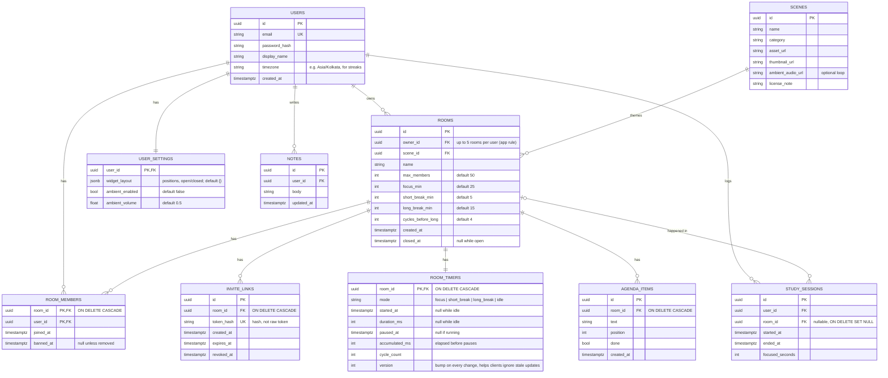

# Data Model (ER Diagram) v0.3

Postgres assumed. NOT in the DB: presence (Redis/memory), chat (Redis, capped list + TTL), host role (derived from presence).

## What changed from v0.1
- **Removed:** `MESSAGES` (chat is Redis), `ACTIVE_TIMERS` (timer now belongs to the room), `SOUND_LAYERS`, `SOUND_PRESETS`, `PRESET_LAYERS` (mixer is a later version), `is_default`, `is_private`, `deleted_at`, `role` on members
- **Added:** `ROOM_TIMERS`, `AGENDA_ITEMS`, `NOTES`, timer durations on `ROOMS`
- **`ROOMS.owner_id` is no longer unique:** a user can own several rooms (limit 5, checked in a transaction). Zero is allowed after deletes.
- **Roles:** owner = `ROOMS.owner_id`. Host is derived from presence at runtime, so it is not a column.

## Design notes
1. **Timer = timestamps.** Remaining = `duration - (now - started_at) - accumulated pauses`. Late joiners, refreshes and second devices all compute the same answer. `version` stops an old update from overwriting a newer one after a reconnect.
2. **Timer writes are cheap and rare.** Only state *changes* (start, pause, reset, skip) are written, never per-second ticks.
3. **Study sessions are written per member** when a focus block completes while they were present. Stats and streaks are computed from this table with the user's timezone; no streak column.
4. **Delete rules:** room deletion cascades to members, invites, timer, agenda. Sessions survive with `room_id = null`.
5. **Member cap (50)** must be enforced in a transaction, because two people can join at the same instant.
6. **Room closure is explicit.** `ROOMS.closed_at` is nullable. A null value means the room is open; a timestamp means it is closed. Non-owners cannot join a closed room, while the owner retains access. Closing a room is distinct from deleting it. The close and reopen workflows must maintain this field consistently.
7. **Indexes to add:** `STUDY_SESSIONS (user_id, started_at)`, `AGENDA_ITEMS (room_id, position)`, `INVITE_LINKS (token_hash)`, `ROOMS (owner_id)`, `ROOM_MEMBERS (user_id)` (to list the rooms I belong to).
8. **The active room is not in the database.** Which room a user is currently in lives in Redis presence (`userId -> activeRoomId`). Joining a second room removes the first. This also stops one focus block being credited in two rooms.
9. **Room limit (5 per owner)** must be checked inside a transaction when creating a room, because two creates can race.
10. **Idle timer rule.** A new room's `ROOM_TIMERS` row is created with `mode = idle`, `started_at = null`, `duration_ms = null`, `accumulated_ms = 0`, `cycle_count = 0`, `version = 0`. `started_at` and `duration_ms` are set on the first `start` and are both null again after `reset` back to idle. `timerService` must treat `mode = idle` as "no remaining time to compute" and never read `started_at` in that state.
11. **Timestamps are `timestamptz`.** Every instant in the schema is stored with its timezone (UTC), matching ADR-003 (timer as server timestamps).
