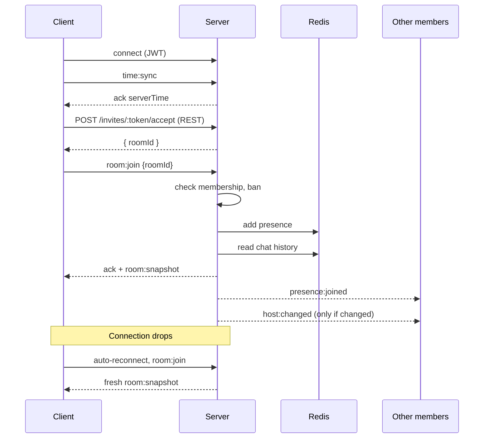
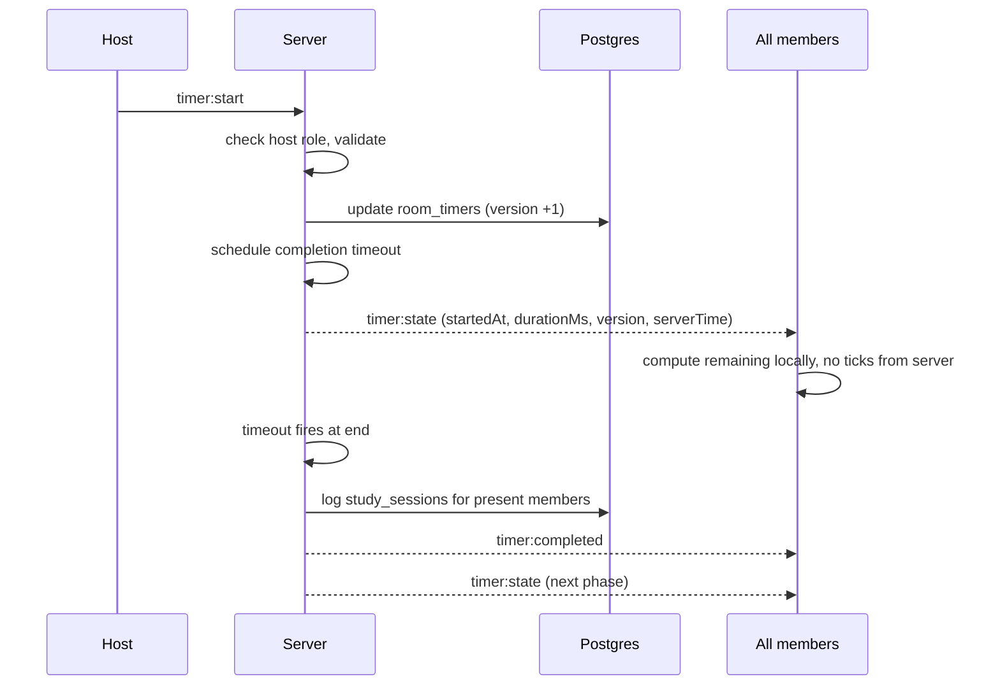

# WebSocket Event Catalog v0.2

Library: Socket.IO. Transport carries *real-time state*. Anything one-off (signup, invite link generation, stats) stays on REST.

## 1. Conventions

- **Naming:** `domain:action`, e.g. `timer:start`.
- **Commands** (client → server): "I want X to happen." The server validates, then applies.
- **Events** (server → client): "X happened." Clients only update shared state from events, never from their own commands.
- **Acks:** every command uses a Socket.IO ack callback returning `{ ok: true, ... }` or `{ ok: false, error: { code, message } }`.
- **Server is authoritative.** The client never decides the time, the host, or who is in the room.
- **Every payload is schema-validated** (e.g. zod). Invalid payload → `INVALID_PAYLOAD`.
- **Auth:** the same `httpOnly` access-token cookie as REST, sent automatically with the handshake (`withCredentials: true`; the server reads it from `socket.handshake.headers.cookie`). JavaScript cannot read an httpOnly cookie, so the client does not put a token in `auth`. No valid token → connection rejected (`UNAUTHENTICATED`).
- **Socket.IO rooms:** each app room maps to a channel `room:{roomId}`. Broadcasts go to that channel only.

## 2. Roles and permissions

| Action | Member | Host | Owner |
|---|---|---|---|
| Join / leave room | yes | yes | yes |
| Update own status | yes | yes | yes |
| Send chat | yes | yes | yes |
| Change scene | no | yes | yes (if host) |
| Control timer, edit agenda | no | yes | yes (if host) |
| Kick member | no | yes | yes (if host) |
| Close room | no | no | yes |
| Delete room | no | no | yes |

Host is derived by the server: the owner if present, else the earliest-joined present member. The owner is host whenever present.

## 3. Connection and join

| Event | Dir | Payload | Notes |
|---|---|---|---|
| `time:sync` | C→S | `{ clientSentAt }` | Ack returns `{ clientSentAt, serverTime }`. Client estimates offset. Run on connect and every ~60 s. |
| `room:join` | C→S | `{ roomId }` | Checks: room exists, caller is a member (membership is created by REST `accept`), not banned. If the caller is active in another room, they are moved out of it (rule 8). Ack returns `snapshot`. |
| `room:leave` | C→S | `{}` | Removes presence immediately. |
| `room:moved` | S→user | `{ fromRoomId, toRoomId }` | Sent to the user's sockets in the old room when they join a different room. Those tabs leave the old room and show "You moved to another room". |
| `room:snapshot` | S→C | see below | Sent on join and after every reconnect. Replaces all local room state. |
| `room:closed` | S→room | `{ roomId }` | Owner closed the room. Members are removed; clients return to the dashboard and see the "room closed" screen. |
| `room:deleted` | S→room | `{ roomId }` | Owner deleted the room. Clients leave and see the "room closed" screen. |

**Snapshot payload:**
```
{
  room: { id, name, ownerId, sceneId, maxMembers },
  members: [{ userId, displayName, status, joinedAt }],
  hostId,
  timer: { mode, startedAt, durationMs, pausedAt, accumulatedMs, cycleCount, version, settings },
  agenda: { items: [...], version },
  chat: [last 50 messages],
  serverTime
}
```

## 4. Presence

| Event | Dir | Payload | Notes |
|---|---|---|---|
| `presence:status` | C→S | `{ status }` | `focusing`, `break`, `away`. Rate limited. |
| `presence:joined` | S→room | `{ userId, displayName, status }` | Not sent for a second tab of the same user. |
| `presence:left` | S→room | `{ userId }` | Sent after the grace period (see 9). |
| `presence:changed` | S→room | `{ userId, status }` | |
| `host:changed` | S→room | `{ hostId }` | Only when the derived host actually changes. |

## 5. Scene

| Event | Dir | Payload | Notes |
|---|---|---|---|
| `scene:change` | C→S | `{ sceneId }` | Host only. Server updates `rooms.scene_id`. |
| `scene:changed` | S→room | `{ sceneId, changedBy }` | |

## 6. Timer

Every timer command results in one broadcast, `timer:state`. Clients derive remaining time themselves; the server never sends per-second ticks.

| Event | Dir | Payload | Notes |
|---|---|---|---|
| `timer:start` | C→S | `{ mode? }` | Host only. Starts a focus block (or the given mode). |
| `timer:pause` | C→S | `{}` | Host only. |
| `timer:resume` | C→S | `{}` | Host only. |
| `timer:reset` | C→S | `{}` | Host only. Back to idle. |
| `timer:skip` | C→S | `{}` | Host only. Ends the current phase, moves to the next. |
| `timer:settings` | C→S | `{ focusMin, shortBreakMin, longBreakMin, cyclesBeforeLong }` | Host only. Bounds-checked. Applies from the next phase. |
| `timer:state` | S→room | `{ mode, startedAt, durationMs, pausedAt, accumulatedMs, cycleCount, version, serverTime }` | Clients ignore any state with `version` lower than what they hold. |
| `timer:completed` | S→room | `{ mode, endedAt, nextMode }` | Server-detected, never client-detected. Triggers in-app notification. |

**Server behaviour:**
- On start/resume, schedule a server timer for the remaining time. When it fires: log study sessions (focus blocks only), advance the phase, broadcast `timer:completed` then `timer:state`.
- On server restart, reload `room_timers` and reschedule from stored timestamps. If a phase already expired while the server was down, complete it on startup.
- Study session credit (v1 default): a member is credited for a focus block if they were present at the start and still present at the end. Because a user is active in only one room, a block can never be credited twice.

## 7. Agenda

Simple model: the server holds the full list with a `version`, and every change broadcasts the whole list. Slightly more bytes, far fewer sync bugs.

| Event | Dir | Payload | Notes |
|---|---|---|---|
| `agenda:add` | C→S | `{ text }` | Host only. Max length, max item count. |
| `agenda:update` | C→S | `{ itemId, text }` | Host only. |
| `agenda:toggle` | C→S | `{ itemId, done }` | Host only. |
| `agenda:reorder` | C→S | `{ itemIds: [...] }` | Host only. |
| `agenda:remove` | C→S | `{ itemId }` | Host only. |
| `agenda:changed` | S→room | `{ items, version }` | |

Personal notes are REST only (not shared, no real-time needed).

## 8. Chat (ephemeral, Redis)

| Event | Dir | Payload | Notes |
|---|---|---|---|
| `chat:send` | C→S | `{ text }` | Trimmed, max 500 chars, rate limited. |
| `chat:message` | S→room | `{ id, userId, displayName, text, sentAt }` | Server pushes to a capped Redis list (100) with a ~3 h TTL. |

Chat history is delivered inside `room:snapshot`. There is no separate history fetch.

## 9. Moderation and errors

| Event | Dir | Payload | Notes |
|---|---|---|---|
| `member:kick` | C→S | `{ userId }` | Host only. Cannot kick the owner. Sets `banned_at`. |
| `member:kicked` | S→target | `{ roomId }` | Target is removed from the channel and returned to the dashboard. |
| `room:close` | C→S | `{}` | Owner only. Remove members, revoke invite link, stop timer, then broadcast `room:closed`. Room and settings stay. |
| `room:delete` | C→S | `{}` | Owner only. Cascade delete, then broadcast `room:deleted`. |
| `error` | S→C | `{ code, message, event }` | For problems outside an ack. |

**Error codes:** `UNAUTHENTICATED`, `FORBIDDEN`, `NOT_FOUND`, `ROOM_FULL`, `BANNED`, `INVALID_PAYLOAD`, `RATE_LIMITED`.

Invite link create / regenerate / revoke are REST endpoints, not socket events.

## 10. Behaviour rules (decide once, implement everywhere)

1. **Disconnect grace period (10 s).** On socket disconnect, do not remove presence immediately. Wait ~10 s; if the user reconnects, nothing changed. This stops refreshes from flickering "left / joined" and from triggering host handoff.
2. **Reconnect = fresh snapshot.** No event replay. After reconnect the client re-emits `room:join` and receives a full snapshot. Simple and robust.
3. **Multiple tabs, one user.** Presence is keyed by `userId` with a socket count. The user "leaves" only when the last socket is gone.
4. **Host handoff.** Recomputed on every presence change. Ties broken by `joined_at`. Emit `host:changed` only when the result differs. Owner returning reclaims host immediately.
5. **Version numbers** on timer and agenda protect against out-of-order delivery after reconnects.
6. **Race conditions:** member cap and duplicate joins are checked server-side inside a transaction or atomic Redis operation.
7. **Single server instance in v1.** With multiple instances you would need the Socket.IO Redis adapter, and exactly one process must own each room's timer schedule. Note this as a known limit in the README.
8. **One active room per user.** Presence is keyed by `userId` with a single `activeRoomId`. When a user joins room B while active in room A, the server removes them from A (emitting `presence:left` there and `room:moved` to their sockets in A) before adding them to B. Several tabs in the *same* room are fine. A user can own up to 5 rooms and belong to many; only the active room matters for presence, timers and chat.

## 11. Rate limits (starting values)

| Action | Limit |
|---|---|
| `chat:send` | 5 per 10 s per user |
| `presence:status` | 10 per 10 s per user |
| `timer:*`, `agenda:*`, `scene:change` | 10 per 10 s per host |
| `room:join` | 10 per minute per user |

## 12. Sequence: join and reconnect



## 13. Sequence: host starts a timer



## 14. Defaults I chose (change if you disagree)

- Late joiner mid-block sees the correct remaining time, but only gets session credit from the *next* block
- Phases do not auto-start: after a block ends, the room goes to the next phase and waits for the host (change to auto-advance if you prefer)
- No client-side optimistic updates for shared state in v1; the UI waits for the server event
- Notifications are derived on the client from `timer:completed`, `presence:joined`, `presence:left`; no dedicated notification event
