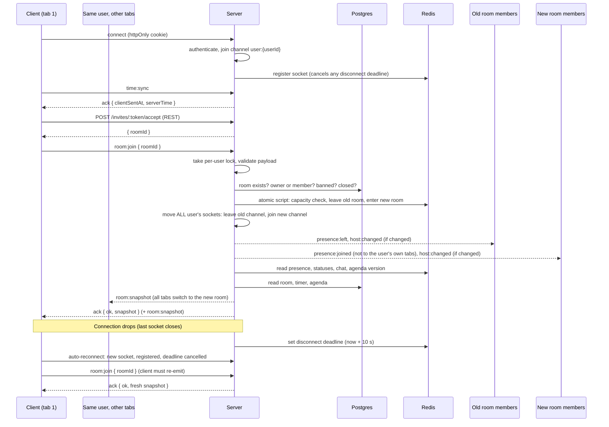
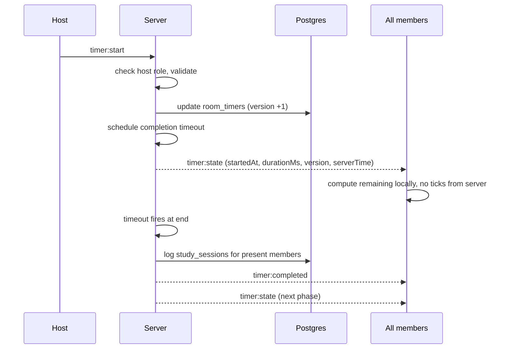

# WebSocket Event Catalog v0.4

v0.4 syncs this catalog with the code in `apps/api` and `packages/shared/src/socket.ts`. Where they differ, the code is the source of truth and this document says so.

Library: Socket.IO. Transport carries *real-time state*. Anything one-off (signup, invite link generation, stats) stays on REST.

## Implementation status

| Event | Direction | Status |
|---|---|---|
| `time:sync` | C→S | Implemented |
| `room:join` | C→S | Implemented |
| `room:leave` | C→S | Implemented |
| `room:snapshot` | S→user's tabs | Implemented |
| `presence:joined` | S→room | Implemented |
| `presence:left` | S→room | Implemented |
| `host:changed` | S→room | Implemented |
| `room:left` | S→user's tabs | Implemented |
| `error` | S→C | Typed, not yet emitted |
| scene, timer, agenda, chat, moderation, `room:close`, `room:delete`, `presence:status` | | Planned (sections below) |

Everything not marked implemented is the design for a later milestone.

## 1. Conventions

- **Naming:** `domain:action`, e.g. `timer:start`.
- **Commands** (client → server): "I want X to happen." The server validates, then applies.
- **Events** (server → client): "X happened." Clients only update shared state from events, never from their own commands.
- **Acks:** every command uses a Socket.IO ack callback returning `{ ok: true, ... }` or `{ ok: false, error: { code, message } }`.
- **Server is authoritative.** The client never decides the time, the host, or who is in the room.
- **Every payload is schema-validated** (e.g. zod). Invalid payload → `INVALID_PAYLOAD`.
- **Auth:** the same `httpOnly` access-token cookie as REST, sent automatically with the handshake (`withCredentials: true`; the server reads it from `socket.handshake.headers.cookie`). JavaScript cannot read an httpOnly cookie, so the client does not put a token in `auth`. No valid token → connection rejected (`UNAUTHENTICATED`).
- **Membership:** the owner is implicitly a member of their own rooms (no `room_members` row needed). Everyone else needs a `room_members` row, created by REST `accept`.
- **Ack shape:** `{ ok: true, ...data }` or `{ ok: false, error: { code, message } }`. Error codes: `UNAUTHENTICATED`, `FORBIDDEN`, `NOT_FOUND`, `ROOM_FULL`, `BANNED`, `INVALID_PAYLOAD`, `RATE_LIMITED`, `INTERNAL`.
- **Timestamps** in payloads are ISO 8601 UTC strings.
- **Per-user channel:** every authenticated socket also joins `user:{userId}`, so the server can address all of one user's tabs at once.
- **Socket.IO rooms:** each app room maps to a channel `room:{roomId}`. Broadcasts go to that channel only.

## 2. Roles and permissions

| Action | Member | Host | Owner |
|---|---|---|---|
| Join / leave room | yes | yes | yes |
| Update own status | yes | yes | yes |
| Send chat | yes | yes | yes |
| Change scene | no | yes | yes (if host) |
| Control timer, edit agenda | no | yes | yes (if host) |
| Kick member | no | yes | yes (if host) |
| Close room | no | no | yes |
| Delete room | no | no | yes |

Host is derived by the server: the owner if present, else the earliest-joined present member. The owner is host whenever present.

## 3. Connection and join

| Event | Dir | Payload | Notes |
|---|---|---|---|
| `time:sync` | C→S | `{ clientSentAt }` (ms number) | Ack: `{ ok: true, clientSentAt, serverTime }` where `serverTime` is an ISO string. Client estimates offset. Run on connect and every ~60 s. |
| `room:join` | C→S | `{ roomId }` | Checks, in order: room exists (`NOT_FOUND`); caller is the owner or a member (`FORBIDDEN`); not banned (`BANNED`); room not closed, unless caller is the owner (`FORBIDDEN`, "This room is closed", based on `rooms.closed_at`); capacity (`ROOM_FULL`). Presence is updated atomically in Redis. If the user was active in another room they are moved out of it, and **every tab of that user follows** (see rule 8). **Ack: `{ ok: true, snapshot }`.** The same snapshot is also pushed as `room:snapshot` to all of the user's tabs. |
| `room:leave` | C→S | `{}` | Removes presence immediately (no grace period). Applies to **every tab** of the user: all are removed from the room channel. Others get `presence:left` and, if the host changed, `host:changed`. The user's tabs get `room:left`. Ack: `{ ok: true }` (also when the user was not in a room). |
| `room:left` | S→user's tabs | `{ roomId }` | The user is no longer in that room (explicit leave). Tabs return to the dashboard. Not sent for a disconnect timeout. |
| `room:snapshot` | S→user's tabs | see below | Pushed to all of the user's tabs after every successful `room:join`, so a tab that did not issue the join switches to the new room. Replaces all local room state. Clients must also handle it as a general "replace everything" message. A dropped connection does **not** produce one automatically: the client must re-emit `room:join` (rule 2). |
| `room:closed` | S→room | `{ roomId }` | Owner closed the room. Sent to everyone except the owner's own sockets, which stay. Clients return to the dashboard and see the "room closed" screen. See rule 9 for ordering. |
| `room:deleted` | S→room | `{ roomId }` | Owner deleted the room. All clients, including the owner's other tabs, leave and see the "room closed" screen. See rule 9 for ordering. |

**Snapshot payload** (`RoomSnapshot` in `packages/shared`):
```
{
  room: { id, name, ownerId, sceneId, maxMembers },
  members: [{ userId, displayName, status, joinedAt }],   // earliest presence first
  hostId: string | null,
  timer: { mode, startedAt|null, durationMs|null, pausedAt|null, accumulatedMs,
           cycleCount, version, settings: { focusMin, shortBreakMin, longBreakMin, cyclesBeforeLong } },
  agenda: { items: [{ id, text, position, done, createdAt }], version },
  chat: [last 50 messages: { id, userId, displayName, text, createdAt }],
  serverTime
}
```

## 4. Presence

| Event | Dir | Payload | Notes |
|---|---|---|---|
| `presence:status` | C→S | `{ status }` | `focusing`, `break`, `away`. Rate limited. |
| `presence:joined` | S→room | `{ userId, displayName, status, joinedAt }` | Not sent for a second tab of the same user, and not sent to the joining user's own tabs. |
| `presence:left` | S→room | `{ userId }` | Sent after the disconnect grace period (rule 1), immediately on explicit `room:leave`, and to the old room when a user moves to another room. |
| `presence:changed` | S→room | `{ userId, status }` | |
| `host:changed` | S→room | `{ roomId, hostId }` (`hostId` is null if the room is empty) | Only when the derived host actually changes; each transition is emitted once. |

## 5. Scene

| Event | Dir | Payload | Notes |
|---|---|---|---|
| `scene:change` | C→S | `{ sceneId }` | Host only. Server updates `rooms.scene_id`. |
| `scene:changed` | S→room | `{ sceneId, changedBy }` | |

## 6. Timer

Every timer command results in one broadcast, `timer:state`. Clients derive remaining time themselves; the server never sends per-second ticks.

| Event | Dir | Payload | Notes |
|---|---|---|---|
| `timer:start` | C→S | `{ mode? }` | Host only. Starts a focus block (or the given mode). |
| `timer:pause` | C→S | `{}` | Host only. |
| `timer:resume` | C→S | `{}` | Host only. |
| `timer:reset` | C→S | `{}` | Host only. Back to idle. |
| `timer:skip` | C→S | `{}` | Host only. Ends the current phase, moves to the next. |
| `timer:settings` | C→S | `{ focusMin, shortBreakMin, longBreakMin, cyclesBeforeLong }` | Host only. Bounds-checked. Applies from the next phase. |
| `timer:state` | S→room | `{ mode, startedAt, durationMs, pausedAt, accumulatedMs, cycleCount, version, serverTime }` | Clients ignore any state with `version` lower than what they hold. |
| `timer:completed` | S→room | `{ mode, endedAt, nextMode }` | Server-detected, never client-detected. Triggers in-app notification. |

**Server behaviour:**
- On start/resume, schedule a server timer for the remaining time. When it fires: log study sessions (focus blocks only), advance the phase, broadcast `timer:completed` then `timer:state`.
- On server restart, reload `room_timers` and reschedule from stored timestamps. If a phase already expired while the server was down, complete it on startup.
- Study session credit (v1 default): when a focus block **starts**, the server records the set of user IDs present at that moment (a Redis set per block, so it survives a restart). When the block completes, credit = that set ∩ the users present at completion. Anyone who joined after the start is not in the set, so late joiners get credit from the next block. Because a user is active in only one room, a block can never be credited twice.
- Only blocks that complete naturally are logged. `timer:skip` or `timer:reset` during a focus block logs no session in v1. (A user who leaves and rejoins mid-block still counts if present at the end; v1 does not track continuous presence.)

## 7. Agenda

Simple model: the server holds the full list with a `version`, and every change broadcasts the whole list. Slightly more bytes, far fewer sync bugs.

| Event | Dir | Payload | Notes |
|---|---|---|---|
| `agenda:add` | C→S | `{ text }` | Host only. Max length, max item count. |
| `agenda:update` | C→S | `{ itemId, text }` | Host only. |
| `agenda:toggle` | C→S | `{ itemId, done }` | Host only. |
| `agenda:reorder` | C→S | `{ itemIds: [...] }` | Host only. |
| `agenda:remove` | C→S | `{ itemId }` | Host only. |
| `agenda:changed` | S→room | `{ items, version }` | |

Personal notes are REST only (not shared, no real-time needed).

## 8. Chat (ephemeral, Redis)

| Event | Dir | Payload | Notes |
|---|---|---|---|
| `chat:send` | C→S | `{ text }` | Trimmed, max 500 chars, rate limited. |
| `chat:message` | S→room | `{ id, userId, displayName, text, createdAt }` | Server pushes to a capped Redis list (100). |

Chat history is delivered inside the `room:join` ack snapshot. There is no separate history fetch.

**Expiry (per message, 3 h):** the list key gets `EXPIRE 3h`, refreshed on every message, only to clean up idle rooms. That alone would be a sliding TTL (a busy room could keep a message for longer than 3 h), so when building a snapshot the server also drops any message with `createdAt` older than 3 h. (The snapshot builder does not filter by age yet; add it when chat is implemented.) Effect: every message disappears from view 3 h after it was sent, and the list is also capped at 100.

## 9. Moderation and errors

| Event | Dir | Payload | Notes |
|---|---|---|---|
| `member:kick` | C→S | `{ userId }` | Host only. Cannot kick the owner. Sets `banned_at`. |
| `member:kicked` | S→target | `{ roomId }` | Target is removed from the channel and returned to the dashboard. |
| `room:close` | C→S | `{}` | Owner only. In one transaction: set `rooms.closed_at`, remove all non-owner members, revoke the invite link, stop the timer. Creating a new invite link clears `closed_at`. After commit: broadcast `room:closed`, then remove the sockets from the channel (rule 9). Room, scene, durations and agenda stay. |
| `room:delete` | C→S | `{}` | Owner only. Cascade delete in one transaction. After commit: broadcast `room:deleted`, then remove the sockets from the channel (rule 9). |
| `error` | S→C | `{ code, message, event }` | For problems outside an ack. |

**Error codes:** see section 1.

Invite link create / regenerate / revoke are REST endpoints, not socket events.

## 10. Behaviour rules (decide once, implement everywhere)

1. **Disconnect grace period (10 s).** On socket disconnect, do not remove presence immediately. Wait ~10 s; if the user reconnects, nothing changed. This stops refreshes from flickering "left / joined" and from triggering host handoff.
2. **Reconnect = rejoin = fresh snapshot.** No event replay. Socket.IO reconnects the transport, but the new socket is in no room. The client must re-emit `room:join`; the snapshot arrives in the ack (and as a push to its tabs). Simple and robust.
3. **Multiple tabs, one user.** Presence is keyed by `userId` with a socket count. The user "leaves" only when the last socket is gone.
4. **Host handoff.** Recomputed on every presence change. Ties broken by `joined_at`. Emit `host:changed` only when the result differs. Owner returning reclaims host immediately.
5. **Version numbers** on timer and agenda protect against out-of-order delivery after reconnects.
6. **Race conditions:** member cap and duplicate joins are checked server-side inside a transaction or atomic Redis operation.
7. **Single server instance in v1.** With multiple instances you would need the Socket.IO Redis adapter, and exactly one process must own each room's timer schedule. Note this as a known limit in the README.
8. **One active room per user; all tabs follow.** Presence is keyed by `userId` with a single active room (Redis `active-room`). When a user joins room B while active in room A, one atomic Redis script removes them from A and adds them to B. The server then moves **all** of the user's sockets (found through `user:{userId}`) out of channel A and into channel B, emits `presence:left` (and any `host:changed`) in A, and pushes `room:snapshot` for B to every tab. There is no `room:moved` event: tabs simply switch rooms when they receive the snapshot. Several tabs in the same room are fine. A user can own up to 5 rooms and belong to many; only the active room matters for presence, timers and chat.
9. **Order of destructive broadcasts.** For `room:close`, `room:delete` and `member:kick`: (1) commit the database change, (2) emit the event to the channel, (3) only then remove the sockets from the channel (`socketsLeave`). Emitting after the commit means members are never told something that did not happen; emitting before removing sockets means they are still in the channel to receive it.
10. **Serialize joins per user.** Join and leave run inside an in-process per-user lock, and the Redis script is atomic, so two tabs joining different rooms at the same instant resolve cleanly (the later one wins and everything follows it). The in-process lock is correct only for a single server instance (rule 7).
11. **Presence is cleared at startup (implemented).** Presence lives in Redis but sockets die with the process, so on boot `clearStalePresence()` scans for and unlinks the presence keys (`room:*:users`, `room:*:statuses`, `room:*:owner`, `user:*:sockets`, `user:*:active-room`) before the cleanup worker starts and before the server listens. Chat and agenda-version keys are deliberately kept.
12. **Disconnect cleanup.** When a user's last socket closes, a deadline (now + 10 s) is stored; a worker polls every second and, if the user has not reconnected, removes them and emits `presence:left` and `host:changed`. A reconnect (a new socket registering) cancels the deadline.

11. **Presence is cleared at startup (implemented).**
    Presence lives in Redis but sockets die with the process. Before the cleanup worker starts and before the server listens, `clearStalePresence()` scans and unlinks:
    - `nekostudy:room:*:users`
    - `nekostudy:room:*:statuses`
    - `nekostudy:room:*:owner`
    - `nekostudy:user:*:sockets`
    - `nekostudy:user:*:active-room`

    It also unlinks the exact sorted-set key `nekostudy:presence:disconnect-deadlines`, so deadlines left by the crashed process are not processed.

    Chat and agenda-version keys are deliberately preserved.
    
## 12. Sequence: join and reconnect



## 13. Sequence: host starts a timer



## 14. Defaults I chose (change if you disagree)

- Late joiner mid-block sees the correct remaining time, but only gets session credit from the *next* block
- Phases do not auto-start: after a block ends, the room goes to the next phase and waits for the host (change to auto-advance if you prefer)
- No client-side optimistic updates for shared state in v1; the UI waits for the server event
- Notifications are derived on the client from `timer:completed`, `presence:joined`, `presence:left`; no dedicated notification event
